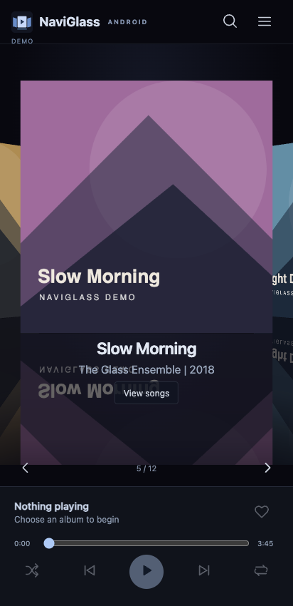
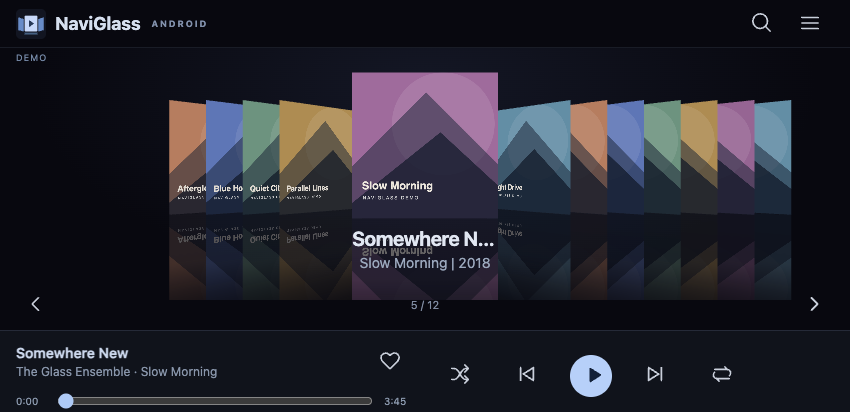

# NaviGlass Android

A local music player that brings NaviGlass Cover Flow to Android. Browse your albums, choose a song, and keep listening when you lock the screen.

This is a **private, early testing project**, not a Play Store release. It is independent of the existing desktop/web players; those projects are not modified by this app.





These screenshots use invented albums and artwork. The browser preview simulates controls for design testing; the APK uses real native playback, not that simulation.

## What is included

- Swipeable, animated Cover Flow with aligned side covers and reflections, adapted from NaviGlass's existing renderer.
- Native Media3 playback: play/pause, previous/next, seeking, shuffle, repeat, audio focus and unplugged-headphone handling.
- A media playback service and Android media session for background listening and system playback controls.
- Device music discovery through Android's MediaStore, or read-only access to a selected music folder through Android's folder picker.
- Cached album/song metadata, scan progress, cancellation and reuse of unchanged selected-folder metadata.
- Search by song, artist or album; favourites and named playlists stored on the device.
- Embedded cover extraction to a bounded cache, at up to 512 pixels. Only nearby Cover Flow textures are loaded, and the scene stops scheduling frames when idle or hidden.
- Portrait and landscape layouts, ellipsised captions, reduced-motion support and a small-space Cover Flow app icon.

## Requirements and formats

Android **10 or later**, with an up-to-date Android System WebView and WebGL support. The test APK works on both ARM and x86 Android devices; no processor-specific native libraries are included.

The selected-folder scanner recognises MP3, FLAC, WAV/WAVE, M4A/M4B, AAC, Ogg/OGA and Opus. Actual playback depends on the file's container/codec and the device's decoder support. Archives and DRM-protected music are not supported. Artwork is read from embedded song metadata; loose `folder.jpg` discovery is not included yet.

## Try the test APK

1. Transfer `NaviGlass-Android-0.1.0-test.apk` from the project's local `builds/` folder to your Android phone.
2. Open it and allow installation from the app you used to open the APK, if Android asks. This is a debug-signed development APK; keep it for testing, not production distribution.
3. Tap **Load device music** and allow the music permission, or tap **Choose a music folder** to grant access only to that folder.
4. Browse albums by swiping. Tap the centre cover or **View songs**, then choose a song or **Play all**.
5. Use the bottom transport controls. Lock the phone to test background playback, and allow notifications when requested for visible playback controls.
6. Open the library menu to search, refresh the selected source, view favourites or create playlists. The `+` beside a song adds it to a playlist.

Previously indexed songs are available immediately on reopening. The first folder scan must read metadata and can be slower on removable or provider-backed storage. Device music uses Android's existing index and is usually quicker. If a folder moves or access expires, select it again.

## Privacy and audio

No login, analytics, advertisements, cloud upload or `INTERNET` permission. All UI libraries are packaged in the APK. The WebView is restricted to bundled assets and authorised cached artwork, with a main-frame, origin-scoped message bridge. Native session requests resolve only indexed song IDs; arbitrary playback URLs are not accepted. Android's folder picker grants read access, never write access. A storage provider selected by the user may have its own network behaviour; choose local device/SD-card storage for fully offline use.

The app does not delete songs, write tags or change original artwork. It does not transcode or re-encode your music. Android still decodes audio and may resample it through the system audio path, Bluetooth or the output device; this is not a bit-perfect/DAC certification.

App data is excluded from Android cloud backup/device transfer. Clearing app data removes the index, favourites, playlists and saved queue, not your music.

## Build from source

Install JDK 17 and the Android SDK. Set `JAVA_HOME` and `ANDROID_HOME` to their locations, or configure an ignored `local.properties` with `sdk.dir`. Install Android platform 36 and build tools 36.0.0, accepting the SDK terms yourself.

```sh
./gradlew :app:assembleDebug :app:lintDebug :app:testDebugUnitTest
```

Output: `app/build/outputs/apk/debug/app-debug.apk`. Gradle 8.13 is pinned with its distribution SHA-256; Android Gradle Plugin is 8.13.2. Dependencies are resolved from Google Maven/Maven Central on the first build. Android Studio is optional for command-line builds.

For the synthetic integration test, use a clean emulator, grant the target app music permission, then run:

```sh
./gradlew :app:connectedDebugAndroidTest
```

The integration test creates and removes only its own synthetic song in the emulator. Do not run development tests against a personal music library. The short tone and invented artwork in test assets are original test fixtures.

The bundled HTML can also be served from `app/src/main/assets` by a local static server. **Explore demo covers** is explicitly a browser design preview, not a web music player or a substitute for APK testing.

## Current limits

This first build needs testing on real phones, SD-card providers, large libraries, Bluetooth devices and manufacturer battery-management settings. A successful emulator run does not guarantee compatibility with every phone. There is no equalizer, gapless certification, Android Auto browser integration, network streaming, album tagging, archive extraction, import/export of playlists or production signing setup yet. Overlapping device and selected-folder scans can show duplicate albums, since their permissions and identifiers are indexed separately. The library thumbnail grid shows the first 120 albums; Cover Flow browses all albums and song search returns at most 200 matching songs. Selected-folder scans are capped at 100,000 songs and 50,000 directories; queues are capped at 10,000 songs.

Before a public release: test multiple physical devices, finalise supported codecs and library-source behaviour, complete an accessibility review, set up a private production signing key and complete release/security review. No signing keys, computer paths, private emails or personal names belong in Git.

## Project structure

- `app/src/main/java/com/naviglass/android/`: activity/secure bridge, library cache/scanner, track model and native playback service.
- `app/src/main/assets/`: offline mobile UI, Cover Flow renderer, small numeric tween engine, synthetic browser preview and bundled Three.js.
- `app/src/main/res/`: Android icon, theme and privacy rules.
- `app/src/test/` and `app/src/androidTest/`: JVM checks and synthetic emulator integration test.
- `docs/`: screenshots and validation notes.

See [third-party notices](THIRD-PARTY-NOTICES.md). No open-source licence is granted for the project's own code at this private testing stage.
